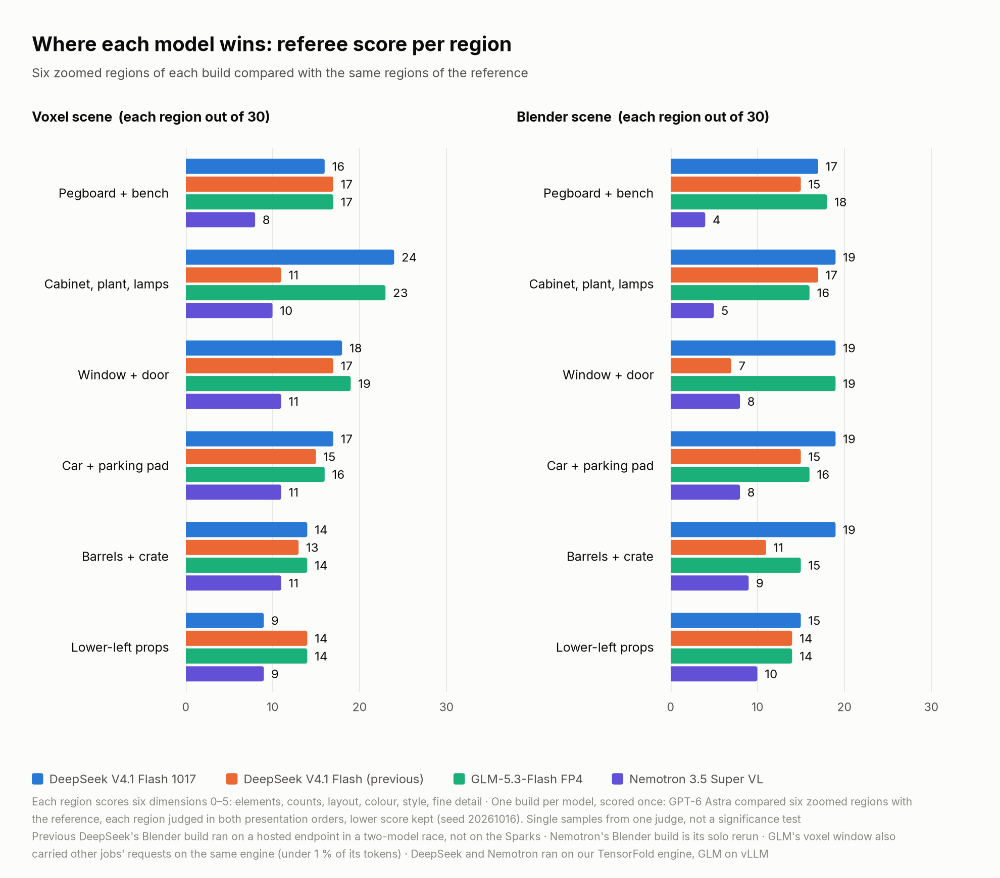
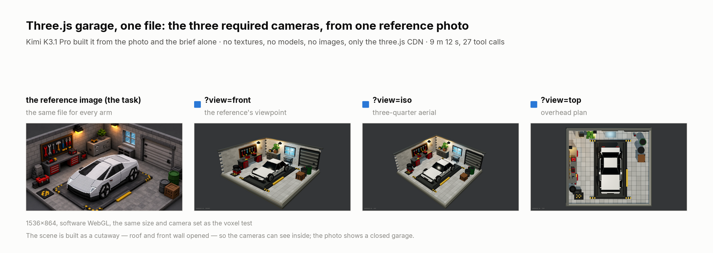
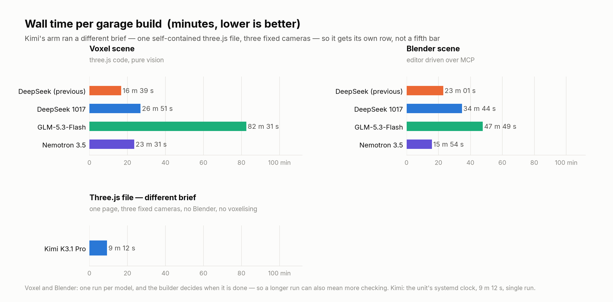
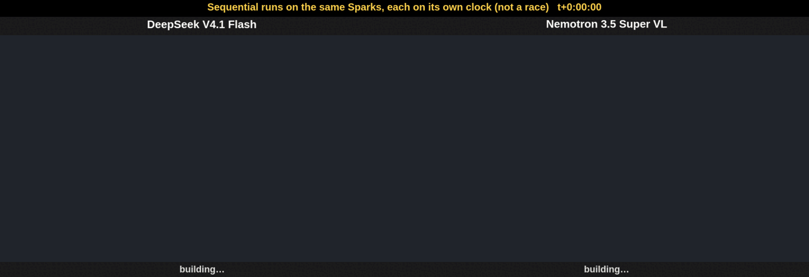
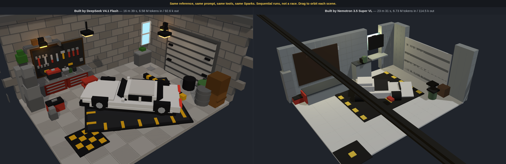
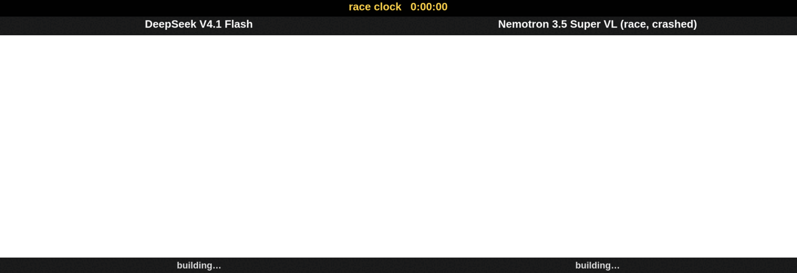
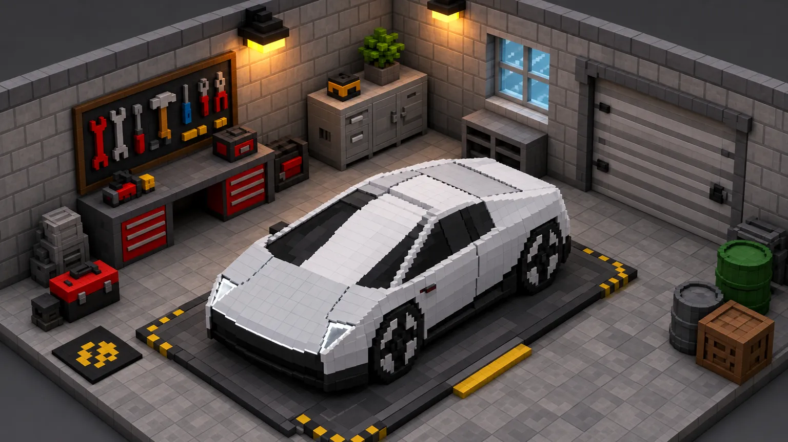
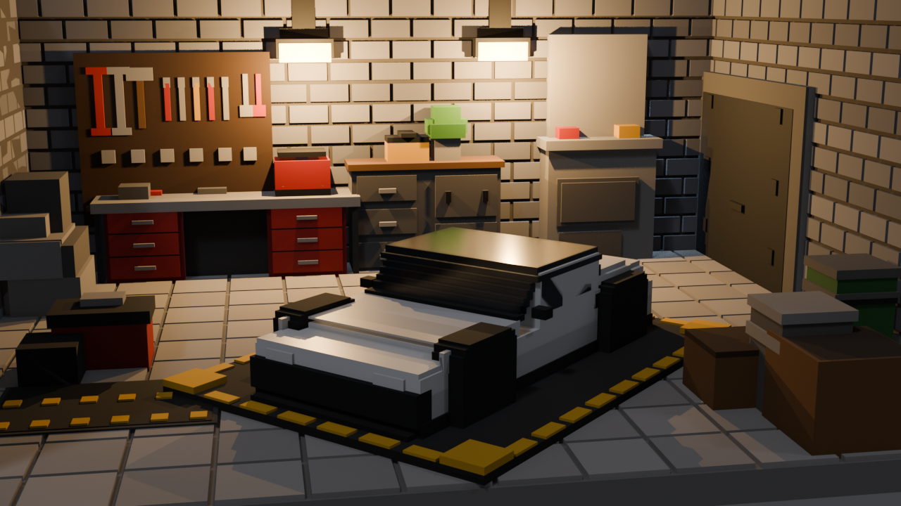
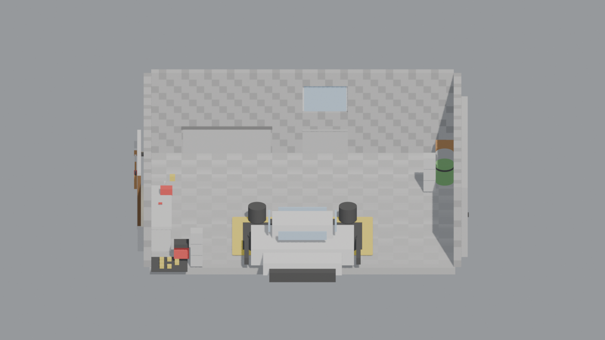
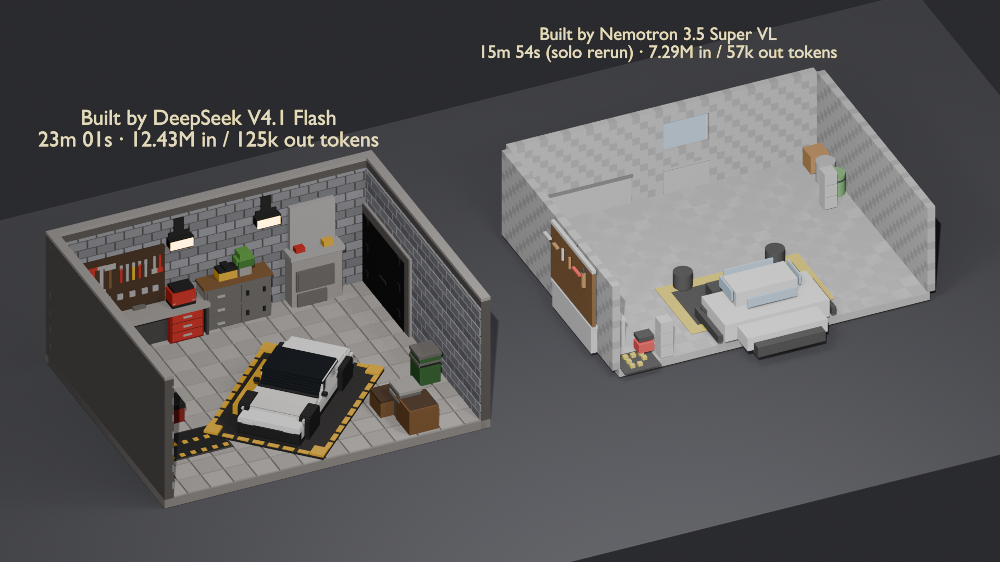

# garage
threejs image to voxel 3d bench

## Four models, both tests (2026-10-17)

Four models have now run both garage tests with the same prompt file (sha256 `f88e8390…` for voxel, `91540b15…` for
Blender), the same reference, starter, tools, caps and referee. The two new runs are **DeepSeek V4.1 Flash 1017**
(DeepSeek's official 1017 checkpoint, 2.9-bit EXL3, on our TensorFold engine on four Sparks) and **GLM-5.3-Flash FP4**
(vLLM on the same four Sparks). Each ran alone, one test at a time.

A fifth arm joined later on a different brief — **Kimi K3.1 Pro**, one self-contained three.js file with three fixed
cameras, 9 m 12 s. It is not in the tables below because the brief and the scoring are not the same; see
[Kimi K3.1 Pro](#kimi-k31-pro-one-threejs-file-three-fixed-cameras-2026-10-23).

<picture>
  <source media="(prefers-color-scheme: dark)" srcset="charts/3d-headline-dark.png">
  
</picture>

| Referee total (/180) | DeepSeek V4.1 Flash 1017 | DeepSeek V4.1 Flash (previous) | GLM-5.3-Flash FP4 | Nemotron 3.5 Super VL |
|---|---:|---:|---:|---:|
| Voxel (three.js code) | 98 | 87 | **103** | 60 |
| Blender over MCP | **108** | 79 | 98 | 44 |
| Wall time, voxel | 26 m 51 s | **16 m 39 s** | 82 m 31 s | 23 m 31 s |
| Wall time, Blender | 34 m 44 s | 23 m 01 s ¹ | 47 m 49 s | **15 m 54 s** ² |

- **1017** has the top Blender score (108; GLM 98, previous DeepSeek 79) and is second on voxel (98; GLM 103). It beats
  the previous DeepSeek on both tests (+11 voxel, +29 Blender), and it took 1.6× (voxel) and 1.5× (Blender) its time.
- **GLM** has the top voxel score and is second on Blender, but it is the slowest on both (82.5 and 47.8 min).
- **Read these as single samples.** One build per model per test, scored once by one judge (GPT-6 Astra; each region
  judged in both presentation orders, lower score kept, seed 20261016). A gap of a few points says nothing about
  significance.
- ¹ The previous DeepSeek's Blender run used a hosted endpoint in a two-model race, not the Sparks.
  ² Nemotron's Blender figure is its solo rerun (its race attempt crashed, see below). GLM's voxel window also carried
  some other jobs' short requests on the same engine (under 1 % of its tokens); its Blender window was clean.

**Where each model wins**, region by region:

<picture>
  <source media="(prefers-color-scheme: dark)" srcset="charts/3d-regions-dark.png">
  
</picture>

The final scenes, labelled:

<picture>
  <source media="(prefers-color-scheme: dark)" srcset="charts/3d-renders-voxel-dark.png">
  
</picture>

<picture>
  <source media="(prefers-color-scheme: dark)" srcset="charts/3d-renders-blender-dark.png">
  
</picture>

Wall time and scores as separate charts: [`charts/3d-wall-time-light.png`](charts/3d-wall-time-light.png),
[`charts/3d-scores-light.png`](charts/3d-scores-light.png) (dark versions next to them). Build records:
[1017 voxel](voxel/deepseek-v4.1-flash-1017/BUILD.md), [1017 Blender](deepseek-v4.1-flash-1017/BUILD.md),
[GLM voxel](voxel/glm-5.3-flash/BUILD.md), [GLM Blender](glm-5.3-flash/BUILD.md).

---

## Kimi K3.1 Pro: one three.js file, three fixed cameras (2026-10-23)

A fifth arm, on a **different brief**, so it is not a fifth row in the table above: one self-contained `index.html`
(three.js from a CDN, no textures, no models, no Blender, no voxelising) and three required cameras —
`?view=front`, `?view=iso`, `?view=top` — instead of a view of the model's choosing. **Kimi K3.1 Pro** ran on its
subscription lane through pi, one run, alone.

<picture>
  <source media="(prefers-color-scheme: dark)" srcset="charts/3d-kimi-renders-dark.png">
  
</picture>

| | Kimi K3.1 Pro |
|---|---:|
| Wall time | **9 m 12 s** |
| Tool calls | 27 (12 shell, 9 read, 3 write, 3 edit) |
| Tokens | 39.4 k in / 20.6 k out |
| Self-checks | 6 screenshots viewed before it called itself done |
| Console errors at load | 6 (one NaN geometry on the car) |
| Deliverable | `index.html`, 17,940 bytes, one file |

What it got right is the composition, and that is the part that is easy to get wrong: the reference is itself a
cutaway — two walls visible, no ceiling, the car angled about 45° across a tiled floor — and the build reproduces all
four of those exactly, not a stylised reinterpretation of them. Also matching: the white car on the black
hazard-striped pad, the pegboard and red drawer cabinets on the left, the roll-up door and blue window on the right,
the warm wall sconces, the plant and radio on the back cabinet.

<picture>
  <source media="(prefers-color-scheme: dark)" srcset="charts/3d-kimi-wall-dark.png">
  
</picture>

- **It is fast, and speed is the least interesting thing about it.** At 9 m 12 s it is quicker than every voxel and
  Blender build here, but it also ran a shorter brief with no referee and no feedback loop, so read the number as
  "this brief, this model", not as a ranking.
- **One real defect:** two malformed hull geometries inside the car group — 26 NaN floats, and one position array
  whose length is not a multiple of three. It renders and the car reads correctly, but the builder's own filtered
  console check reported zero errors and the page actually logs six. Shipped is not the same as finished.
- **Caveats:** single run, single build, no referee score; the screenshots were re-taken by the orchestrator, not
  taken on the builder's word. Run record and reproduction steps: [`kimi-k3.1-pro/BUILD.md`](kimi-k3.1-pro/BUILD.md).

---

## Rerun: pure vision → three.js voxel scene, no Blender (2026-10-16)

The garage is voxel art, so a Blender scene was the wrong target. This rerun builds it the direct way: each model
looks at `ref.webp` and writes a **three.js scene made of boxes**. No Blender, no Blender MCP, no 3D-model
generators, no downloaded assets. It has only code, its own eyes (the vision harness, pointed at its own model) and
headless-Chromium screenshots of its own page. Both models ran **on our own Spark servers** through the same
`sparks/auto` route: DeepSeek V4.1 Flash first, then the Sparks were swapped to Nemotron 3.5 Super VL for the
identical task. These are **sequential runs, not a race**.

*One frame every 10 minutes of each run's own clock, same fixed camera and viewport, plus the final frame.
Per-model GIFs: [DeepSeek](voxel/timelapse/deepseek-v4.1-flash.gif), [Nemotron](voxel/timelapse/nemotron-3.5-super-vl.gif).
Both live scenes side by side: [`voxel/combined/index.html`](voxel/combined/index.html) (serve the repo with any
static server).*

### What was held equal
- The same builder prompt, byte for byte (one file, identical SHA-256 for both runs), the same reference, and the
  same starter: an empty three.js r180 page with a fixed default camera and a local web server.
- The same tools: bash/read/write/edit, the vision harness on the builder's own model, and a screenshot helper. pi's
  `images.blockImages` was on for both, so all looking went through the harness.
- The same 2 h cap. Neither came close.
- Separate working folders. An audit of both sessions afterwards shows neither builder touched anything outside
  its own folder, apart from its own task file and report.

### Results

| Model | Wall time | Tokens in (cached) | Tokens out | Agent turns | Tool calls (errors) | Vision harness | Screenshots | Finished? |
|---|---|---|---|---|---|---|---|---|
| DeepSeek V4.1 Flash | **16 m 39 s** | 6.58 M (6.36 M) | 92.6 k | 74 | 87 (1) | 51 runs, 84 model calls | 18 | yes |
| Nemotron 3.5 Super VL | 23 m 31 s | 6.73 M (6.47 M) | 114.5 k | 57 | 60 (5) | 25 runs, 55 model calls | 18 | yes |
| DeepSeek V4.1 Flash 1017 (2026-10-17) | 26 m 51 s | 9.34 M (9.08 M) | 159.8 k | 74 | 73 (2) | 26 runs, 39 model calls | 13 | yes |
| GLM-5.3-Flash FP4 (2026-10-17) | 82 m 31 s | 14.63 M (14.34 M) ³ | 290.0 k ³ | 81 | 81 (3) | 55 runs, 76 model calls | 11 | yes |

- **Tokens** come from the Spark server's own counters, before and after each run: agent plus vision harness. For
  Nemotron, pi's per-request usage plus the harness log equals the server delta to the token. For DeepSeek, pi
  records no usage on this route. There, the server counted exactly 158 requests (74 agent turns + 84 vision
  calls), so nothing else is mixed in. Splits are in each `BUILD.md`.
- **Errors:** DeepSeek's one error was a Python one-liner it wrote. All five of Nemotron's were malformed `edit`
  calls.
- **1017** ran on the same engine, image and settings as the DeepSeek run, with DeepSeek's 1017 checkpoint loaded
  (113 requests = 74 turns + 39 vision calls, exact). Its two errors were Python one-liners importing modules that
  are not installed. **GLM** ran on vLLM on the same Sparks.
- ³ GLM's window also carried 67 short requests from other jobs on the same engine (well under 1 % of the tokens), so
  its token figures are an upper bound. Details in [`voxel/glm-5.3-flash/BUILD.md`](voxel/glm-5.3-flash/BUILD.md).

### Zoomed referee pass

Same referee as the Blender bake-off: GPT-6 Astra, a neutral third model. The same six regions and questions, each
cropped from the reference and from each builder's final default-view screenshot, judged at 2× zoom. Each pair was
judged twice, with the reference first and then second (seed 20261016), and the lower score was kept.
Boxes: [`voxel/referee/regions.json`](voxel/referee/regions.json). Raw verdicts:
[`voxel/referee/results.jsonl`](voxel/referee/results.jsonl).

| Region (each /30) | DeepSeek | Nemotron | DeepSeek 1017 | GLM-5.3-Flash |
|---|---|---|---|---|
| Pegboard + workbench | **17** | 8 | 16 | **17** |
| Cabinet, plant, lamps | 11 | 10 | **24** | 23 |
| Window + roll-up door | 17 | 11 | 18 | **19** |
| Car on its pad | 15 | 11 | **17** | 16 |
| Barrels + crate | 13 | 11 | **14** | **14** |
| Lower-left props + mat | **14** | 9 | 9 | **14** |
| **Total (/180)** | **87** | **60** | **98** | **103** |

Between the first two, DeepSeek wins all six regions. Its verdicts flipped with presentation order on 6 dimensions, Nemotron's on 11.
The 2026-10-17 runs were scored the same way, one build at a time with the same seed (1017: [`results-d17.jsonl`](voxel/referee/results-d17.jsonl), 9 flips; GLM: [`results-glm.jsonl`](voxel/referee/results-glm.jsonl), 4 flips).
Bold marks the best of the four in each region.

**A pixel check, independent of every model**
([`voxel/referee/sanity.json`](voxel/referee/sanity.json)). Each final screenshot vs the reference:
- colour-histogram overlap: DeepSeek 0.77, Nemotron 0.56 (the empty starter page scores 0.22);
- empty background: DeepSeek 23 %, Nemotron 50 %;
- DeepSeek's shares of the reference's red, yellow, green and sky-blue are near the reference's own. Nemotron has
  almost no green or sky blue, and only about a third of the red and yellow.
- 2026-10-17, same script: 1017 0.47 overlap / 2 % empty (its scene is darker and warmer, with a navy sky where the
  reference is grey), GLM 0.69 / 0 % ([`sanity-d17.json`](voxel/referee/sanity-d17.json),
  [`sanity-glm.json`](voxel/referee/sanity-glm.json)). The pixel check ranks 1017 lowest on overlap while the
  referee ranks it second; it measures colour, not objects.

### Reading the two scenes
- **DeepSeek** has the room most of the way there by its first snapshot at 10 minutes. It has brick walls,
  pegboard and tools, red drawer units, cabinet and plant, lamps, window, a slatted door with hinges, the pad with
  yellow markings, barrels, crates and the checkered mat. Then it spent the time comparing crops. Weak spots: the
  car is a boxy saloon rather than the reference's wedge, its panels are big rather than voxel-fine, and the
  checkered mat is oversized. It also scaled the room by 1.22 to fill the fixed camera.
- **Nemotron** got the plan right: two walls, pegboard and bench, cabinet, door, a pad with markings, barrels,
  crate and mat. The execution is rough. A long black bar crosses the picture: four window-pane calls are missing
  an argument, so a colour constant became a depth of about 10 million units. Its own vision called it "a thick
  long black beam", but it didn't find the cause. The car reads as loose white blocks, and the walls are plain
  grey.

- **DeepSeek 1017** (2026-10-17) scores best of the four on the cabinet corner (24/30) and the car (17). Its weak
  spot is the lower-left corner (9): a stack of dark crates where the reference has grey blocks, a red toolbox and a
  mat. It measured the reference's pixels itself and used the vision harness about half as often as the previous
  DeepSeek (39 vs 84 calls).
- **GLM-5.3-Flash** (2026-10-17) has no weak region (its lowest is 14/30, the highest floor of the four) and has the top total, but it spent about
  35 minutes on its inventory before writing the scene.

Details per model: [`voxel/deepseek-v4.1-flash/BUILD.md`](voxel/deepseek-v4.1-flash/BUILD.md),
[`voxel/nemotron-3.5-super-vl/BUILD.md`](voxel/nemotron-3.5-super-vl/BUILD.md),
[`voxel/deepseek-v4.1-flash-1017/BUILD.md`](voxel/deepseek-v4.1-flash-1017/BUILD.md),
[`voxel/glm-5.3-flash/BUILD.md`](voxel/glm-5.3-flash/BUILD.md).

---

*Below: the first bake-off, which built Blender scenes through a Blender MCP server.*

*Race timelapse, both builders started together (2026-10-16, 01:59 PDT). DeepSeek finished at 23:01. Nemotron crashed at
22:54. MP4: [`timelapse/side-by-side.mp4`](timelapse/side-by-side.mp4). Nemotron's solo rerun next to DeepSeek, each on
its own clock: [`timelapse/side-by-side-rerun.gif`](timelapse/side-by-side-rerun.gif).*

## The bake-off

Two vision-capable models each built the garage in `ref.webp` as a voxel-style Blender scene:

- **DeepSeek V4.1 Flash**, served by Venice
- **Nemotron 3.5 Super VL**, NVIDIA's 120B-A12B NVFP4 model on our own Spark servers

Each builder was a coding agent (a pi worker) with the same tools: a Blender MCP server, the same vision harness, and
bash/read/write/edit. The harness was pointed at the builder's **own** model, so each one saw the reference with its own
eyes. Venice lists DeepSeek V4.1 Flash with `supportsVision: true`, and an image probe through the harness answered
correctly, so no substitute vision model was involved.

Both builders also got:
- the identical prompt and reference;
- a 2 h 30 min cap;
- a fresh, empty, headless Blender each, on its own port. Isolation was proven before the start: a test object created by
  each builder through its own MCP config was visible only in its own Blender.

They ran **at the same time**, as Jun asked, so we'd know who finishes first. This doubles as a tool-use benchmark, so
tool calls are recorded too.

| Reference | DeepSeek V4.1 Flash | Nemotron 3.5 Super VL (solo rerun) |
|---|---|---|
|  |  |  |

Each builder's own 3/4 render is shown (the 2026-10-17 renders are in the [four-model grid](#four-models-both-tests-2026-10-17)). Front and top views, the `.blend`, the GLB and a build record are in
[`deepseek-v4.1-flash/`](deepseek-v4.1-flash/BUILD.md) and [`nemotron-3.5-super-vl/`](nemotron-3.5-super-vl/BUILD.md).
Nemotron's crashed race build is in [`nemotron-3.5-super-vl/race-attempt/`](nemotron-3.5-super-vl/race-attempt/).
The 2026-10-17 builds: [`deepseek-v4.1-flash-1017/`](deepseek-v4.1-flash-1017/BUILD.md) and [`glm-5.3-flash/`](glm-5.3-flash/BUILD.md).

## Results

| Model | Run | Wall time | Tokens in | Tokens out | Tool calls | MCP calls / errors | Other tool errors | Vision harness | Finished? |
|---|---|---|---|---|---|---|---|---|---|
| DeepSeek V4.1 Flash | race | **23 m 01 s** | 12.43 M (12.30 M cached) | 125.4 k | 87 | 25 / 2 | 1 | 18 runs, 22 model calls | **yes, the race's only finisher** |
| Nemotron 3.5 Super VL | race | 22 m 54 s | 7.50 M (7.29 M cached) | 99.0 k | 66 | 5 / 4 | 4 | 0 (looked in the wrong folder) | **no, crashed** (server rejected a 9-image request; the limit is 8) |
| Nemotron 3.5 Super VL | solo rerun¹ | **15 m 54 s** | 7.29 M (7.09 M cached) | 57.4 k | 76 | 21 / 8 | 3 | 14 runs, 40 model calls | yes |
| DeepSeek V4.1 Flash 1017 | solo, 2026-10-17 ² | 34 m 44 s | 17.39 M (agent; 17.43 M with harness, 17.15 M cached) | 245.3 k | 116 | 32 / 1 | 0 | 30 runs, 38 model calls | yes |
| GLM-5.3-Flash FP4 | solo, 2026-10-17 ² | 47 m 49 s | 17.47 M (agent; 17.55 M with harness, 17.36 M cached) | 133.9 k | 114 | 43 / 1 | 1 | 30 runs, 34 model calls | yes |

- **Tokens** are pi's per-request usage. "In" includes cache reads. Vision-harness tokens are separate: DeepSeek
  40.4 k in / 12.5 k out, Nemotron rerun 72.4 k / 9.3 k. For the rerun, the Spark server's own token counters moved by
  exactly pi + harness (+7.37 M prompt, +66.7 k generated), which cross-checks the numbers.
- **Wall time** is the builder's process lifetime, from its start to its exit.
- **¹ The rerun.** Nemotron's race run died because pi kept pasting its renders into the chat context and hit the
  server's 8-image-per-request limit. The rerun is the same task, alone, after the race, with **one labelled change**:
  pi's `images.blockImages` was on, so Nemotron could see images only through the vision harness. That is how DeepSeek
  worked all along, because pi treats DeepSeek V4.1 Flash as text-only. It is not a race result.
- **² The 2026-10-17 runs** are solo runs on our four Sparks with the rerun's setup (`images.blockImages` on, its own
  fresh Blender on its own port). 1017 ran on our TensorFold engine, GLM on vLLM. pi records no usage on these routes,
  so tokens come from the Spark server's counters: the agent's share is the server delta minus the harness's own log,
  and the request counts reconcile exactly (1017: 144 = 106 turns + 38 vision calls; GLM: 149 = 115 + 34). One 1017
  turn hit the output cap after 8 minutes of reasoning without a tool call; the worker wrapper resumed the session
  once and the build went on (counted in the totals).
- **Time cap and memory.** Neither builder came near the 2.5 h cap. Free memory stayed above 12.8 GB throughout,
  logged every 2 minutes.

### Tool use, in short
- **DeepSeek** stayed on the Blender MCP the whole time: it wrote a `build.py` and executed it through
  `execute_blender_code`, with 2 errors, each fixed on the next call. It used the vision harness for an inventory, then
  for zoomed crops of single regions. It also solved its camera against 8 landmarks measured off the reference.
- **Nemotron, race:** it looked for the vision harness in the wrong folder, decided the harness didn't exist, and looked
  at renders by pasting them into its context instead. After 4 MCP errors in a row it abandoned the MCP and ran its own
  headless Blender subprocess (10 times). The 9th pasted image crashed it.
- **Nemotron, rerun:** MCP throughout, with 8 errors, mostly Blender 5.2 API drift. It used the vision harness 14 times,
  but its own vision misread voxel objects (the car as a "bed") and called small crops "completely black", so it avoided
  crops.

## Zoomed referee pass

This follows the `zoomed-referee-pass` method and Kai's recreation rubric. Six regions of `ref.webp` were cropped and
compared, at 2× zoom, with the same regions of each builder's 3/4 render. Each region was scored 0–5 on six dimensions:
elements, counts, layout, colour, style and detail at zoom.

- **Judge:** a neutral third model, GPT-6 Astra, which is neither contestant.
- **Blinding:** each pair was judged twice, with the reference shown first in one run and second in the other (seed
  20261016). Where the two runs disagreed, the lower score was kept.
- **Files:** the crop boxes are in [`referee/regions.json`](referee/regions.json) and the raw verdicts in
  [`referee/results.jsonl`](referee/results.jsonl).

| Region (each /30) | DeepSeek | Nemotron (rerun) | DeepSeek 1017 | GLM-5.3-Flash |
|---|---|---|---|---|
| Pegboard + workbench | 15 | 4 | 17 | **18** |
| Cabinet, plant, lamps | 17 | 5 | **19** | 16 |
| Window + roll-up door | 7 | 8 | **19** | **19** |
| Car on its pad | 15 | 8 | **19** | 16 |
| Barrels + crate | 11 | 9 | **19** | 15 |
| Lower-left props + mat | 14 | 10 | **15** | 14 |
| **Total (/180)** | **79** | **44** | **108** | **98** |

Bold marks the best of the four. The 2026-10-17 builds were scored the same way, one at a time with the same seed ([`results-d17.jsonl`](referee/results-d17.jsonl), [`results-glm.jsonl`](referee/results-glm.jsonl)). 1017 leads or ties five of the six regions; GLM leads the pegboard and ties the window.

Under Kai's pass rule, **none of the four garages counts as "recreated"**: every region still has missing elements or wrong counts. The best region score is 19/30, and fine detail scores 1–2 everywhere.

**Judgement.** DeepSeek V4.1 Flash built the better garage, and it isn't close. It matched the reference's camera,
palette and layout: brick walls, a pegboard with readable tools, red drawer units, the cabinet with its plant, two warm
lamps, a striped parking pad, barrels and a crate. It won five of the six zoomed regions. Its weak spots are real:
- the car reads as a blocky wedge or pickup rather than the sleek coupe;
- the window renders as an opaque panel and the roll-up door as a hinged door;
- the lighting is flatter than the reference.

Nemotron 3.5 Super VL was faster and cheaper once it got going: its solo rerun took 15 m 54 s on 7.3 M / 57 k tokens,
against DeepSeek's 23 m 01 s on 12.4 M / 125 k. But it lost the actual race by crashing at 22 m 54 s. Its finished rerun
names most of the right objects, yet delivers a pale, low-contrast, near-frontal view: checkerboard walls instead of
brick, a car whose wheels stand up off the body, a pegboard that can't be seen from its own 3/4 camera, and no visible
lamps. On this task DeepSeek's vision was the more useful pair of eyes. It drove targeted crop checks that changed the
build. Nemotron's own reads mislabelled voxel objects, so it relied on coordinates instead of looking.

## Combined scene
[`combined/`](combined/) has a Blender scene and renders with both garages side by side on one ground plane, with
floating labels. It also has a small three.js viewer, [`combined/index.html`](combined/index.html), which loads both GLBs
side by side with the same labels. Serve the repo over http (e.g. `npx serve .`) and open `/combined/`; there's a
screenshot in `combined/viewer-screenshot.png`.

## Timelapse
The orchestrator, not the builders, snapshotted each scene every 10 minutes from t=0 (the empty scene) plus a final frame.
It rendered a copy of each scene from one fixed camera in Workbench, so the builders' time and tokens stayed clean.
- Frames: `timelapse/<model>/frame-NNN-<minutes>m.png`.
- GIFs: one per model, plus the side-by-side ones.
- [`timelapse/NOTES.md`](timelapse/NOTES.md) covers the details, including why Nemotron's race frames at 10 and 20 min
  show only its MCP scene.
